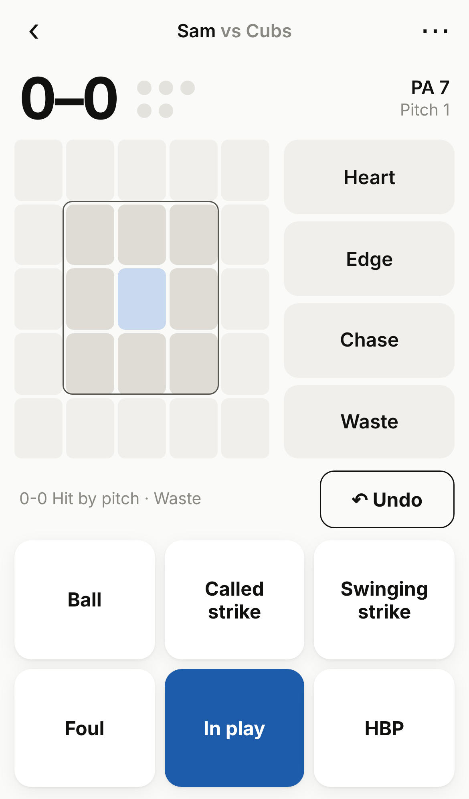

# Bleacher Stats

Log your kid's at-bats pitch by pitch from the stands, and see what they swing at, what they miss,
and how it changes over the season.

Live: https://bleacherstats.netlify.app (free Netlify hosting, deployed automatically from `main`).

- Mobile-first web app that installs to the home screen and works with no signal.
- No accounts. Games live on the phone (localStorage); backups and CSV export are in Settings.
- Plain HTML, CSS and JavaScript. No build step.



## Modes

New users pick one on the welcome screen; it can be changed on the New game form or in Settings.
Switching never deletes data, only what's logged and shown.

| | Basic | Standard | Advanced |
|---|---|---|---|
| Per pitch | What happened (1 tap) | Where it was + what happened | Same, plus optional pitch type |
| Ball in play | Result | Contact, field location, result | Also ground ball / liner / fly / popup |
| Reports | Swing and miss, strikeout rate, pitches per PA | Swing decisions, hot/cold heat map, spray chart | Every stat, count and pitch-type splits |

The count, walks, strikeouts and the end of each plate appearance are automatic. **Undo** removes the
last pitch; **⋯ → Fix a pitch** changes or deletes any pitch, and everything recalculates. The **⋯** menu
also ends a PA without a pitch (intentional walk, runner out) and has **End game**, which shows a
shareable game summary. A one-time explainer covers Heart, Edge, Chase and Waste.

## Screens

- **Games**: game list, season card, backup and install reminders.
- **Player**: a scouting-style page with slash line, blue-to-red rating sliders, heat map, spray chart.
  **Edit** renames a player (or merges a typo into an existing one), sets jersey number and which side
  they bat from, so the heat map reads inside/away.
- **Reports**: per game or season, with a **Share** button that makes an image for texting.
- **Settings**: mode, an in-app help page (How it works), feedback, export, backup/restore,
  usage-count opt-out.

Rating sliders use fixed cutoffs in `SCALE` in `public/js/stats.js`. They are a general guide set by
judgment, not percentiles; have a hitting coach review them. "Early read" marks stats with few pitches
(`MIN_N` in the same file).

## Feedback and usage counts (Netlify)

- **Feedback** (Settings → Send feedback) submits to Netlify Forms, form `feedback`. See messages in
  Netlify → site → Forms; add an email notification there to get each one by email.
- **Usage counts**: the app sends event names only (opened today, game started, 3rd game, share…)
  to `/api/track`, which keeps daily totals in Netlify Blobs. No IDs, cookies or game data.
  View them at `/stats.html#key=<STATS_KEY>`; `STATS_KEY` is a Netlify environment variable.
  People can turn this off in Settings.

## Paid tier (built, switched off)

`public/js/config.js` has `pro.enabled: false` and `features.insights` / `features.trends` set to
false. Turning Pro on as built moves the season heat map, spray chart and count splits behind it,
which would take them away from existing users: charge only for new features instead.
Stripe checkout and a purchase check (`server/verify-core.js`, `netlify/functions/verify.js`,
`api/verify.js`) are ready; set `STRIPE_SECRET_KEY` and the plan links in the config to use them.

## Run and test

```bash
npm install
```

```bash
npm test
```

```bash
npm start
```

Then open http://localhost:8080. Usage counts are not sent from localhost.

When you change files in `public/`, bump `VERSION` in `public/sw.js` so installed phones update.

## Layout

- `public/`: the app (published folder)
  - `index.html`, `css/app.css`, `js/app.js` (screens), `js/stats.js` (all stat math, unit-tested),
    `js/store.js`, `js/field.js`, `js/share.js`, `js/usage.js`, `js/feedback.js`, `js/pro.js`, `js/config.js`
  - `sw.js`, `manifest.webmanifest`, `icons/`: offline and install
  - `privacy.html`, `stats.html`
- `netlify/functions/`, `server/`: usage counts and the optional purchase check
- `moved/`: the page at the old address (atbat-log.netlify.app), a separate Netlify site, that moves
  games saved there to the new address
- `tests/`: `npm test`
